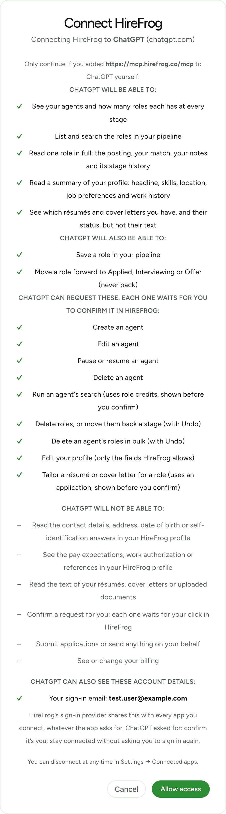

# HireFrog for Claude and ChatGPT

Use your [HireFrog](https://hirefrog.co) job search from your own Claude or
ChatGPT. Ask "what's in my pipeline?", "tell me about the Stripe role", or
"move it to Applied", and your assistant answers from your real HireFrog
account.

**Connector address:** `https://mcp.hirefrog.co/mcp`

This repository is the connector's public documentation and security
policy. The connector itself is hosted by HireFrog: there is nothing here to
install or run.

You need a HireFrog account.

Claude and ChatGPT rename their menus from time to time, so the names below
may differ slightly from what you see. In ChatGPT, the menu may be called
**Connectors**, **Apps** or **Plugins**.

## Connect to Claude

1. In Claude, open **Settings → Connectors → Add custom connector**.
2. Name it **HireFrog** and enter `https://mcp.hirefrog.co/mcp`.
3. Click **Connect**. Sign in to HireFrog if asked. Check that the approval
   page says it's connecting to **Claude (claude.ai)**, then approve.

Works in Claude on the web, Claude Desktop and Claude mobile. On Claude Team
and Enterprise plans, an Owner adds the connector first.

## Connect to ChatGPT

1. In ChatGPT, open **Plugins → Add** (it may say **Connectors** or **Apps**
   instead of Plugins) and choose **Add custom MCP server**.
2. Fill in:
   - **Icon** (optional): [the HireFrog icon](https://hirefrog.co/connectors/hirefrog-icon-256.png) (PNG, 256×256, under 10 KB).
   - **Name:** `HireFrog`
   - **Description:** `Your HireFrog job search: agents, roles in your pipeline and a summary of your profile.`
   - **Connection:** Server URL, `https://mcp.hirefrog.co/mcp`
   - **Authentication:** OAuth
3. Open **Advanced OAuth settings** and keep only the default scopes `openid`
   and `offline_access`. HireFrog doesn't need your email, phone or profile.
4. Tick **I understand and want to continue**, then **Create as a plugin**.
5. Sign in to HireFrog if asked. Check that the approval page says it's
   connecting to **ChatGPT (chatgpt.com)**, then approve.

The same steps are at
[hirefrog.co/developers/mcp/quickstart](https://hirefrog.co/developers/mcp/quickstart).

## The approval page

Before anything connects, HireFrog shows which assistant is asking, what it
will and won't be able to do, and which of your account details it can see.
If the request didn't come from Claude or ChatGPT, it offers only Cancel.

*HireFrog's approval page for ChatGPT, shown with a test account.*

## What your assistant can do

**Read** your HireFrog job search:
- see your agents (including their search filters, such as a salary range) and how many roles each has at every stage;
- list and search the roles in your pipeline;
- read one role in full: the posting, your match, your notes and its stage history;
- read a summary of your profile: name, headline, skills, location, job preferences and work history;
- see which résumés and cover letters you have, and their status, but not their text.

**Change**, directly:
- save a role in your pipeline;
- move a role forward to Applied, Interviewing or Offer (never back).

**Ask you first.** Everything else is a request. Your assistant gives you a
link, you open it in HireFrog, see exactly what will happen (and what it
costs, if anything), and confirm or cancel:
- create, edit, pause, resume or delete an agent;
- run an agent's search (uses role credits);
- delete roles, or move them back a stage (you can undo a deletion for a few minutes);
- edit your profile (only the fields HireFrog allows);
- tailor a résumé or cover letter for a role (uses an application).

Your assistant **can't**:
- confirm a request for you;
- read the contact details, address, date of birth or self-identification answers in your HireFrog profile;
- see the pay expectations, work authorization or references in your profile;
- read the text of your résumés, cover letters or uploaded documents;
- submit applications or send anything on your behalf;
- see or change your billing.

Each result includes an **Open in HireFrog** link to the same role, agent or page.

## Privacy

- **What HireFrog keeps:** a daily count of requests per tool and per app, so
  you can see your usage in Settings, never your questions or the answers.
  When your assistant asks for a change that you confirm in HireFrog,
  HireFrog stores that request, with exactly what it would change, until you
  confirm or cancel it or it expires after 24 hours, and deletes it one day
  after that. If it made a tailored résumé or cover letter, HireFrog
  keeps it for 30 days so you can still review and save the documents.
- **What the assistant's company sees:** whatever your assistant reads goes
  to Anthropic (Claude) or OpenAI (ChatGPT), and they handle it under their
  own terms, like anything else you share with them.
- **Your sign-in details:** your assistant signs in through HireFrog's
  sign-in provider, Supabase, which shares a few account details with every
  app you connect, whatever the app asks for: your sign-in email, your phone
  number if one is on your account, and your name and profile picture if you
  signed in with Google. The approval page lists the ones your account has
  before you approve. HireFrog's own tools never return them.
- Full details: [Privacy Policy](https://hirefrog.co/privacy) and
  [AI Data Use Policy](https://hirefrog.co/ai-data-use-policy).

## Limits

Per HireFrog account, across all your connected apps: 60 requests a minute
and 2,000 a day; 120 direct changes an hour; 30 requests to confirm a day,
with at most 20 waiting at once. Requests expire after 24 hours.

## Disconnect

In HireFrog, open **Settings → Connected apps** and click **Disconnect**.
Your assistant loses access straight away, including any sign-in it already
holds. You can also remove the connector in Claude or ChatGPT.

## Troubleshooting

- **"HireFrog only connects to Claude and ChatGPT…"** The connection didn't
  come from Claude's or ChatGPT's own sign-in, or you disconnected it. Add
  HireFrog again from Claude or ChatGPT.
- **The approval page shows only Cancel.** The app asking isn't Claude or
  ChatGPT. If you didn't start this yourself from Claude or ChatGPT, cancel it.
- **"HireFrog allows 60 requests a minute…"** Wait the time shown.
- **"This request expired."** Requests last 24 hours. Ask your assistant again.

Questions: support@hirefrog.co.

---

## For developers

- **Protocol:** MCP over Streamable HTTP at `https://mcp.hirefrog.co/mcp`,
  tools only.
- **Authorization:** OAuth 2.1 with PKCE (S256) through HireFrog's Supabase
  Auth server, with dynamic client registration. Protected resource metadata
  is at `/.well-known/oauth-protected-resource/mcp`; the 401 challenge and
  the metadata ask for `openid offline_access` only.
- **Which apps:** only clients whose every registered redirect URI is on
  `claude.ai` or `chatgpt.com` exactly (https, no port, no subdomain) are
  approved. Everything else is refused by the server and by the database.
- **Tokens:** every request's token is verified against HireFrog's Auth
  server; a HireFrog browser session is refused.
- **Runs as you:** every read and write runs on your own token under
  HireFrog's database access rules. The server holds no administrator key.
- **Requests and confirmation:** a request is stored by the database with its
  exact arguments; only HireFrog's own page, under your normal sign-in, turns
  it into a card and runs it after your click. A connector token can never
  confirm, change or delete a request.
- **Untrusted text:** text from job postings and other third parties comes
  back wrapped as `{"untrusted": true, "source": …, "text": …}` between
  `<<<untrusted …>>>` and `<<<end untrusted>>>` markers, and the server's
  instructions tell the model to treat it as data.
- **Tools:** read: `get_overview`, `list_roles`, `get_role`,
  `get_profile_summary`, `list_materials`. Write (forward only): `save_role`,
  `advance_role`. Request: `request_create_agent`, `request_update_agent`,
  `request_set_agent_active`, `request_delete_agent`,
  `request_run_agent_search`, `request_update_roles`,
  `request_dismiss_agent_roles`, `request_update_profile`,
  `request_tailor_documents`.

Security issues: see [SECURITY.md](SECURITY.md).

Privacy: https://hirefrog.co/privacy

## License

[MIT](LICENSE)
